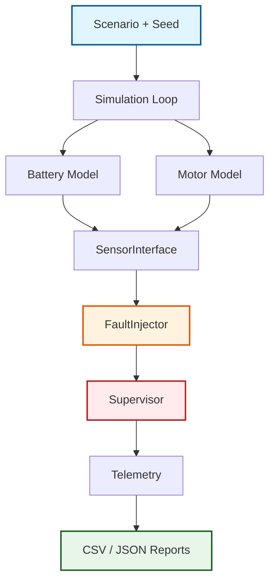
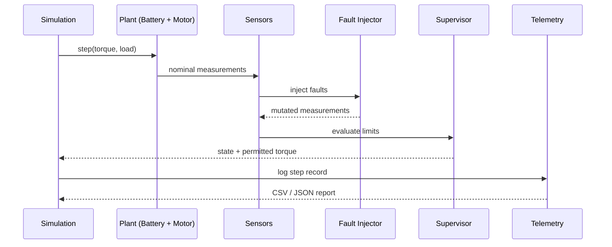
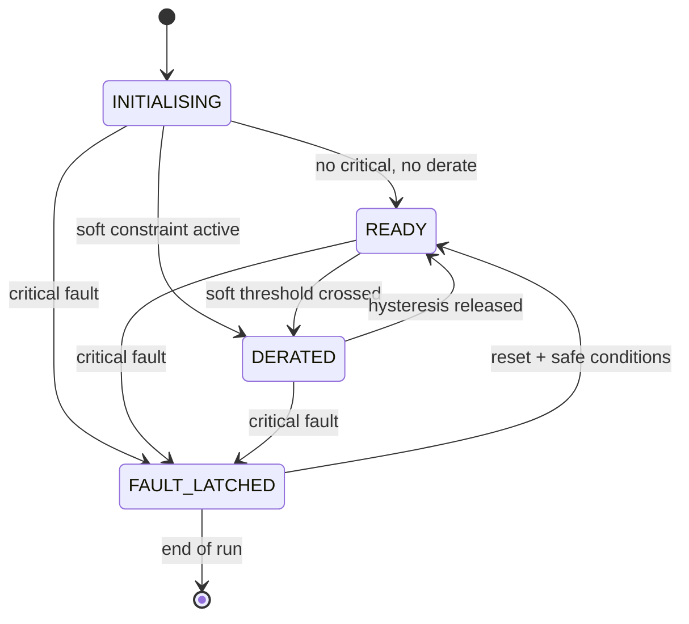

<p align="center">
  <h1 align="center">⚡ EV-Verify</h1>
  <p align="center">
    <b>A deterministic e-powertrain verification test bench.</b><br>
    Simulation-first, requirements-traced, branch-covered — built for clarity, not production.
  </p>
</p>

<p align="center">
  
  
  
  
  
  
</p>

---

<p align="center">
  <b>⚠️ Simulation only — not a production BMS, digital twin, HIL system, or safety-certified system.</b><br>
  All defaults are illustrative simulation values, not manufacturer specifications.
</p>

---

## ✨ Overview

EV-Verify is a **discrete-time, deterministic simulation** of an electric powertrain
(battery + motor) with a supervisor protection layer and sensor fault injection
at the measurement boundary. Every scenario uses a fixed seed — no network, no
clock, no hardware — so runs are fully reproducible.

> **Plant ground truth is sacred.** Faults mutate only the *measurement* the
> supervisor sees. The simulation's hidden state is never touched.

---

## 🏗️ Architecture





---

## 📦 Project Structure

```text
EV-VERIFY/
├── .github/workflows/ci.yml      # CI: ruff, pytest+branch coverage, traceability
├── README.md                     # you are here
├── AGENTS.md                     # commands & project notes
├── pyproject.toml                # packaging + pytest + ruff config
├── src/ev_verify/
│   ├── __init__.py
│   ├── config.py                 # AppConfig — single source of constants
│   ├── battery.py                # BatteryPack — SOC, OCV, terminal voltage, heat
│   ├── motor.py                  # Motor — rotational dynamics, DC current
│   ├── sensors.py                # Measurement + SensorInterface
│   ├── fault_injection.py        # FaultSchedule + FaultInjector (stale persists)
│   ├── supervisor.py             # State machine: INITIALISING → READY → DERATED → FAULT_LATCHED
│   ├── simulation.py             # Simulation engine — fixed dt loop
│   ├── scenarios.py              # 10 built-in deterministic scenarios
│   ├── telemetry.py              # StepRecord + RunSummary + CSV/JSON output
│   └── cli.py                    # list-scenarios / run / run-all
├── tests/
│   ├── unit/                     # battery, motor, sensors, fault_injection, supervisor, telemetry
│   ├── integration/              # scenario-level + fault transition tests
│   ├── property/                 # Hypothesis invariants (SOC ∈ [0,1], …)
│   ├── conftest.py               # requirement-marker traceability report
│   └── test_traceability.py
├── config/                       # simulation configuration
├── requirements/requirements.json# 20 traced requirements (REQ-*)
├── scripts/check_traceability.py # requirements → tests traceability checker
├── reports/                      # traceability.json + generated scenario outputs
└── docs/
    ├── architecture.md
    ├── requirements_traceability.md
    ├── test_strategy.md
    └── assumptions_and_limitations.md
```

---

## 🚀 Quick Start

Create and activate a virtual environment (PowerShell):

```powershell
python -m venv .venv
.\.venv\Scripts\Activate.ps1
pip install -e ".[dev]"
```

Run the test suite with branch coverage:

```powershell
pytest --cov=ev_verify --cov-branch --cov-report=term-missing --cov-report=xml
```

Verify every implemented requirement has a test:

```powershell
python scripts/check_traceability.py
```

Run a single scenario:

```powershell
python -m ev_verify.cli run --scenario normal_city_drive --seed 42
```

Run all scenarios:

```powershell
python -m ev_verify.cli run-all --seed 42
```

List available scenarios:

```powershell
python -m ev_verify.cli list-scenarios
```

---

## 📊 Scenario Catalog

| Scenario | Duration | What it exercises | Expected outcome |
|---|---:|---|---|
| `normal_city_drive` | 20 s | Variable traction, stops, cruise | READY, no faults |
| `steady_cruise` | 20 s | Constant moderate torque | Stable READY |
| `hard_acceleration` | 10 s | 600 Nm demand (> 400 Nm limit) | FAULT_LATCHED, over-current |
| `regenerative_braking` | 15 s | Negative torque while rotating | Negative pack current, charge limit |
| `low_soc` | 20 s | Start SOC 0.22 near derate | Derating → hard limit |
| `thermal_stress` | 60 s | Warm ambient + sustained load | Temp rise, derating, over-temp trip |
| `sensor_dropout` | 15 s | Pack voltage dropout at t=3 s | Detection, latch, reset at t=9 s |
| `sensor_spike` | 15 s | 500 V voltage spike at t=5 s | Over-voltage latch |
| `sensor_bias` | 15 s | −80 A current bias at t=4 s | Biased measurement, no trip |
| `stale_sensor` | 15 s | Temp timestamp frozen at t=4 s | Stale detection after 1 s timeout |

---

## 🧪 Requirements Traceability

All 20 requirements are implemented and traced to automated tests.

| ID | Description | Sev. | Tests |
|---|---|---|---|
| REQ-BAT-001 | SOC stays in `[0, 1]` under charge/discharge | high | `test_battery.py`, `test_invariants.py` |
| REQ-BAT-002 | +current ↓SOC, −current ↑SOC (coulomb counting) | high | `test_battery.py` |
| REQ-BAT-003 | Terminal voltage = OCV − I·R | high | `test_battery.py` |
| REQ-BAT-004 | Temp rises under load, cools toward ambient | medium | `test_battery.py` |
| REQ-MOT-001 | +torque ↑ motor speed | high | `test_motor.py` |
| REQ-MOT-002 | Applied torque never exceeds supervisor limit | high | `test_supervisor.py`, `test_normal_drive.py` |
| REQ-MOT-003 | Regenerative torque → negative pack current | high | `test_regenerative_braking.py` |
| REQ-SEN-001 | Invalid / missing / non-finite measurements rejected | high | `test_sensors.py`, `test_supervisor.py` |
| REQ-SEN-002 | Stale measurements detected via timestamps | high | `test_sensors.py` |
| REQ-BMS-001 | Critical over-voltage → latched fault, zero torque | high | `test_supervisor.py`, `test_fault_transitions.py` |
| REQ-BMS-002 | Critical under-voltage → latched fault, zero torque | high | `test_supervisor.py`, `test_fault_transitions.py` |
| REQ-BMS-003 | Discharge over-current → protective fault | high | `test_supervisor.py` |
| REQ-BMS-004 | Regen charge current constrained by charge limit | medium | `test_supervisor.py`, `test_regenerative_braking.py` |
| REQ-BMS-005 | Critical battery temp → protective fault | high | `test_supervisor.py`, `test_fault_transitions.py` |
| REQ-BMS-006 | Sensor dropout / invalid data → safe response | high | `test_fault_transitions.py`, `test_fault_recovery.py` |
| REQ-BMS-007 | Soft constraints → torque derating before critical | medium | `test_supervisor.py`, `test_low_soc.py` |
| REQ-BMS-008 | Fault latched until reset + safe recovery | high | `test_fault_recovery.py` |
| REQ-SIM-001 | Identical scenario+seed → identical traces | high | `test_normal_drive.py` |
| REQ-LOG-001 | Each step records time, scenario, torque, SOC, V, I, temp, speed, state, faults | medium | `test_normal_drive.py`, `test_telemetry.py` |
| REQ-VER-001 | Every implemented requirement ≥1 automated test | high | `scripts/check_traceability.py` |

Run the traceability check:

```powershell
python scripts/check_traceability.py
```

Expected: `20/20 = 100.0% — RESULT: PASS`

---

## 🔬 Supervisor State Machine



States: **INITIALISING** → **READY** → **DERATED** → **FAULT_LATCHED**.
Critical faults trip strictly above/below thresholds (`>`, `<`); soft derating uses hysteresis to avoid chattering.

---

## 🛠️ CLI Reference

```
python -m ev_verify.cli list-scenarios
python -m ev_verify.cli run --scenario <name> --seed 42 --duration 20 --output reports/generated
python -m ev_verify.cli run-all --seed 42 --output reports/generated
```

Scenario outputs are written to `reports/generated/` as `<scenario>_seed<seed>.csv` and `.json`.

---

## 🔒 Assumptions & Limitations

- **Not a production system.** Not a BMS, digital twin, HIL, or safety-certified tool.
- All defaults are **illustrative simulation values** — not manufacturer specs.
- Deterministic seeds; no network, current time, or hardware dependencies.
- Sensor faults are injected at the measurement boundary and never mutate plant ground truth.
- Branch coverage measured with `pytest --cov-branch`; some modules are exercised via integration/scenario paths.

See `docs/assumptions_and_limitations.md` for the full statement.

---

## 📄 License

MIT. See the repository for details.

---

<p align="center">
  Built with ⚡ for verification, not production.
</p>
