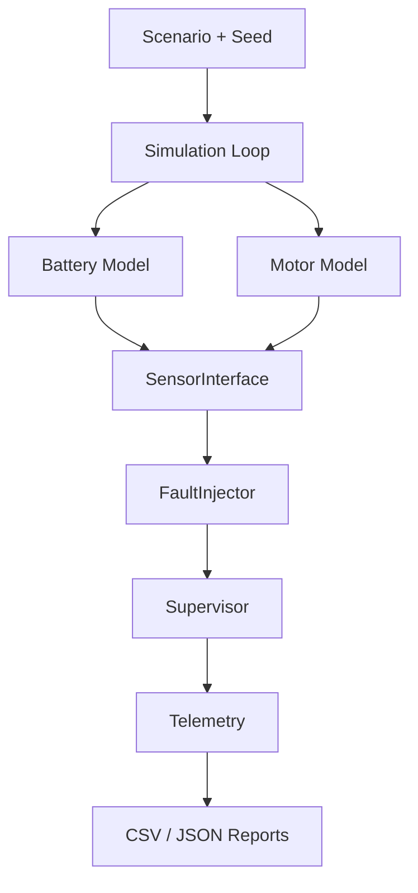
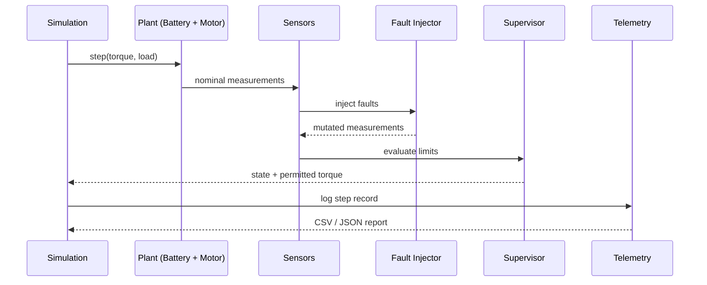
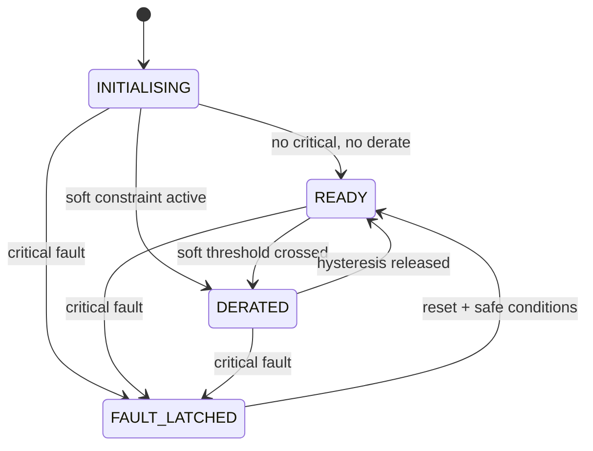

<p align="center">
  <h1 align="center">EV-Verify</h1>
  <p align="center">
    <b>A deterministic e-powertrain verification test bench.</b><br>
    Simulates battery and motor behavior under drive-cycle scenarios, evaluates
    them through a supervisor protection layer, injects sensor faults at the
    measurement boundary, and records structured telemetry for every step.
  </p>
</p>

<p align="center">
  
  
  
  
  
  
</p>

---

## Purpose

EV-Verify provides a repeatable, self-contained environment for validating
e-powertrain supervisory behavior. The test bench simulates a battery and motor
under drive-cycle scenarios, evaluates the results through a supervisor
protection layer, injects sensor faults at the measurement boundary, and
records structured telemetry for every simulation step.

Every scenario uses a fixed seed and has no dependence on network, wall-clock
time, or hardware, so results are identical across runs. This makes EV-Verify
suitable for regression checking, requirements traceability, and demonstrating
that protection functions such as over-voltage, under-voltage, over-current,
over-temperature, sensor dropout, and stale-sensor detection behave as
specified.

## What was built

EV-Verify consists of a simulation core, a scenario library, a test suite, and
a command-line interface.

**Simulation core (`src/ev_verify/`)**
- `config.py` — `AppConfig`: single source of all simulation constants
  (battery, motor, supervisor, simulation timing).
- `battery.py` — `BatteryPack`: low-order equivalent-circuit model tracking SOC,
  open-circuit voltage, terminal voltage (`OCV - I·R`), resistive heating, and
  first-order thermal response.
- `motor.py` — `Motor`: first-order rotational dynamics converting applied and
  load torque into speed, mechanical power, and DC current.
- `sensors.py` — `Measurement` and `SensorInterface`: converts plant ground
  truth into typed sensor measurements the supervisor consumes.
- `fault_injection.py` — `FaultSchedule` and `FaultInjector`: applies dropout,
  stale, spike, bias, and noise faults at the measurement boundary only; plant
  ground truth is never mutated.
- `supervisor.py` — deterministic state machine
  (`INITIALISING`, `READY`, `DERATED`, `FAULT_LATCHED`) evaluating critical
  thresholds, soft derating with hysteresis, and latch/reset behavior.
- `simulation.py` — `Simulation`: fixed-time-step loop advancing plant, sensors,
  faults, supervisor, and telemetry together.
- `scenarios.py` — ten built-in deterministic scenarios covering normal drive,
  steady cruise, hard acceleration, regenerative braking, low SOC, thermal
  stress, sensor dropout, sensor spike, sensor bias, and stale sensor.
- `telemetry.py` — `TelemetryLogger`: per-step records plus aggregated run
  summary written to CSV and JSON.
- `cli.py` — `list-scenarios`, `run`, and `run-all` commands.

**Tests (`tests/`)**
- `tests/unit/` — unit tests for battery, motor, sensors, fault injection,
  supervisor, and telemetry.
- `tests/integration/` — scenario-level and fault-transition tests.
- `tests/property/` — property-based invariants (for example, SOC remains
  within `[0, 1]`).
- `tests/conftest.py` — collects `@pytest.mark.requirement` markers into a
  traceability report.
- `tests/test_traceability.py` — verifies every implemented requirement has a
  covering test.

**Supporting tooling**
- `scripts/check_traceability.py` — compares collected requirement markers
  against `requirements/requirements.json` and fails on any uncovered
  implemented requirement.
- `.github/workflows/ci.yml` — CI running ruff lint/format, pytest with branch
  coverage, and the traceability checker on Python 3.11 and 3.12.
- `docs/` — architecture, requirements traceability, test strategy, and
  assumptions and limitations.

## Architecture







## Project structure

```text
EV-VERIFY/
├── .github/workflows/ci.yml      # CI: ruff, pytest+branch coverage, traceability
├── README.md
├── AGENTS.md                     # commands and project notes
├── pyproject.toml                # packaging, pytest, and ruff configuration
├── src/ev_verify/                # simulation core and CLI
├── tests/                        # unit, integration, and property tests
├── config/                       # simulation configuration
├── requirements/requirements.json# 20 traced requirements
├── scripts/check_traceability.py # requirements-to-tests traceability checker
├── reports/                      # traceability report and scenario outputs
└── docs/                         # architecture, traceability, test strategy, limitations
```

## Scenario catalog

| Scenario | Duration | What it exercises | Expected outcome |
|---|---:|---|---|
| `normal_city_drive` | 20 s | Variable traction, stops, cruise | READY, no faults |
| `steady_cruise` | 20 s | Constant moderate torque | Stable READY |
| `hard_acceleration` | 10 s | 600 Nm demand (> 400 Nm limit) | FAULT_LATCHED, over-current |
| `regenerative_braking` | 15 s | Negative torque while rotating | Negative pack current, charge limit |
| `low_soc` | 20 s | Start SOC 0.22 near derate | Derating → hard limit |
| `thermal_stress` | 60 s | Warm ambient + sustained load | Temp rise, derating, over-temp trip |
| `sensor_dropout` | 15 s | Pack voltage dropout at t=3 s | Detection, latch, reset at t=9 s |
| `sensor_spike` | 15 s | 500 V voltage spike at t=5 s | Over-voltage latch |
| `sensor_bias` | 15 s | −80 A current bias at t=4 s | Biased measurement, no trip |
| `stale_sensor` | 15 s | Temp timestamp frozen at t=4 s | Stale detection after 1 s timeout |

## Requirements traceability

EV-Verify traces 20 requirements (IDs `REQ-BAT-001` through `REQ-VER-001`),
each implemented and linked to at least one automated test.

| ID | Description | Sev. | Tests |
|---|---|---|---|
| REQ-BAT-001 | SOC stays in `[0, 1]` under charge/discharge | high | `test_battery.py`, `test_invariants.py` |
| REQ-BAT-002 | +current ↓SOC, −current ↑SOC (coulomb counting) | high | `test_battery.py` |
| REQ-BAT-003 | Terminal voltage = OCV − I·R | high | `test_battery.py` |
| REQ-BAT-004 | Temp rises under load, cools toward ambient | medium | `test_battery.py` |
| REQ-MOT-001 | +torque ↑ motor speed | high | `test_motor.py` |
| REQ-MOT-002 | Applied torque never exceeds supervisor limit | high | `test_supervisor.py`, `test_normal_drive.py` |
| REQ-MOT-003 | Regenerative torque → negative pack current | high | `test_regenerative_braking.py` |
| REQ-SEN-001 | Invalid / missing / non-finite measurements rejected | high | `test_sensors.py`, `test_supervisor.py` |
| REQ-SEN-002 | Stale measurements detected via timestamps | high | `test_sensors.py` |
| REQ-BMS-001 | Critical over-voltage → latched fault, zero torque | high | `test_supervisor.py`, `test_fault_transitions.py` |
| REQ-BMS-002 | Critical under-voltage → latched fault, zero torque | high | `test_supervisor.py`, `test_fault_transitions.py` |
| REQ-BMS-003 | Discharge over-current → protective fault | high | `test_supervisor.py` |
| REQ-BMS-004 | Regen charge current constrained by charge limit | medium | `test_supervisor.py`, `test_regenerative_braking.py` |
| REQ-BMS-005 | Critical battery temp → protective fault | high | `test_supervisor.py`, `test_fault_transitions.py` |
| REQ-BMS-006 | Sensor dropout / invalid data → safe response | high | `test_fault_transitions.py`, `test_fault_recovery.py` |
| REQ-BMS-007 | Soft constraints → torque derating before critical | medium | `test_supervisor.py`, `test_low_soc.py` |
| REQ-BMS-008 | Fault latched until reset + safe recovery | high | `test_fault_recovery.py` |
| REQ-SIM-001 | Identical scenario+seed → identical traces | high | `test_normal_drive.py` |
| REQ-LOG-001 | Each step records time, scenario, torque, SOC, V, I, temp, speed, state, faults | medium | `test_normal_drive.py`, `test_telemetry.py` |
| REQ-VER-001 | Every implemented requirement ≥1 automated test | high | `scripts/check_traceability.py` |

Run the traceability check:

```powershell
python scripts/check_traceability.py
```

Expected result: `20 / 20 = 100.0% — RESULT: PASS`

## Current quality

| Check | Result |
|---|---|
| Tests | 86 passed |
| Lint (ruff check) | Pass |
| Format (ruff format --check) | Pass |
| Branch coverage | 79% |
| Requirements traceability | 20 / 20 covered (100%) |
| Scenarios executed | 10 / 10 complete, no hangs |

Across all ten scenarios run with seed 42, every scenario reaches a final state
within its step budget. Protective scenarios correctly latch into
`FAULT_LATCHED` with zero commanded torque. Nominal scenarios remain `READY`
or `DERATED` without spurious trips. The `sensor_dropout` scenario detects the
fault, latches, and recovers after an explicit reset at t = 9 s.

## How to run

Create and activate a virtual environment:

```powershell
python -m venv .venv
.\.venv\Scripts\Activate.ps1
pip install -e ".[dev]"
```

Run the full test suite with branch coverage:

```powershell
pytest --cov=ev_verify --cov-branch --cov-report=term-missing --cov-report=xml
```

Verify requirements traceability:

```powershell
python scripts/check_traceability.py
```

Run lint and format checks:

```powershell
ruff check src tests scripts
ruff format --check src tests scripts
```

Run a single scenario:

```powershell
python -m ev_verify.cli run --scenario normal_city_drive --seed 42
```

Run all scenarios:

```powershell
python -m ev_verify.cli run-all --seed 42
```

List available scenarios:

```powershell
python -m ev_verify.cli list-scenarios
```

Scenario outputs (CSV and JSON) are written to `reports/generated/`.

## License

MIT.